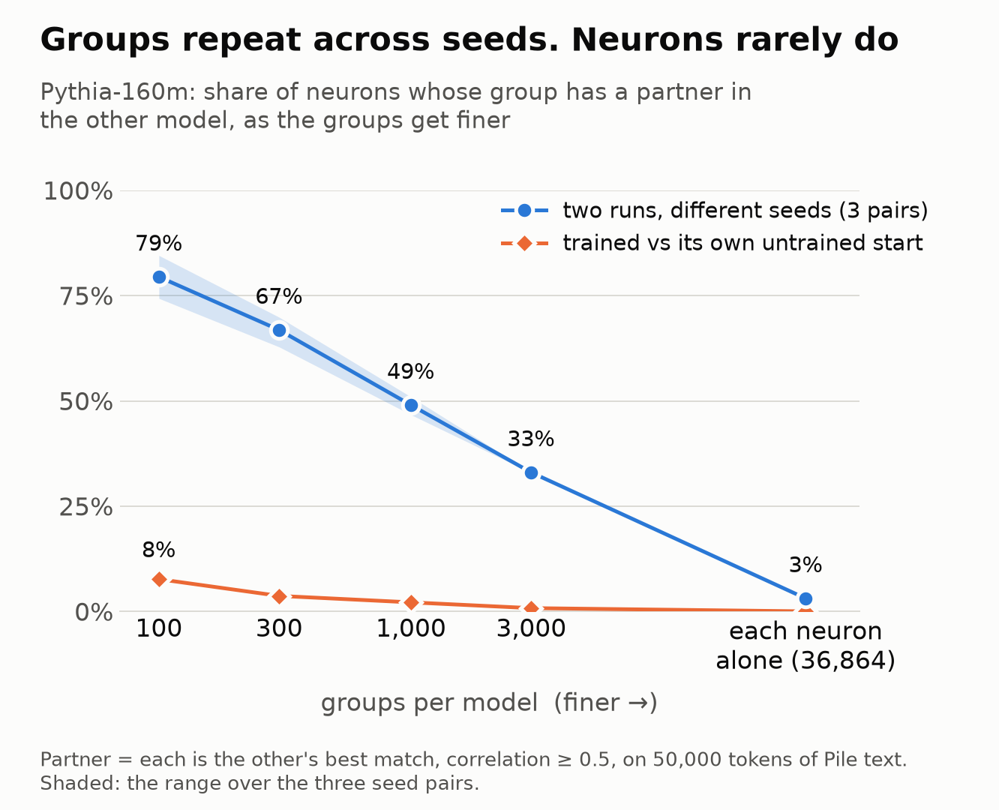

# 01 · groups, not neurons

**The claim we checked.** The [Encyclopedia of LLM homologies](https://qwen-neuron-map.pages.dev/) (an anonymous neuron map of 30 models) says that two training runs of the same recipe, started from different random seeds, "pair up neuron by neuron 9% of the time, and group by group for 67% of their neurons. Structure repeats at the level of groups, not neurons." The site doesn't publish code or its exact matching rules. So we rebuilt the test from scratch on a laptop, wrote our predictions down first (logbook, 2026-11-21 22:52), and scored them the next night (00:18).

**Short answer: the shape holds.** Single neurons rarely have a twin in the other run. Groups of neurons mostly do.

## What we did

- **Models.** [Pythia-160m](https://github.com/EleutherAI/pythia) and two of its [PolyPythias](https://arxiv.org/abs/2503.09543) siblings (`seed1`, `seed2`): the same data in the same order, only the random start differs. Their first-layer weights are unrelated (cosine 0.002). As a null, the untrained start of the first run (`step0`).
- **Text.** 75,000 token positions from a sample of the Pile ([NeelNanda/pile-10k](https://huggingface.co/datasets/NeelNanda/pile-10k)): the first 25,000 to form groups, the next 50,000 for every comparison.
- **Neurons.** All 36,864 MLP neurons per model (12 layers × 3,072), after the GELU.
- **Twins.** Two neurons in different models are twins when each is the other's best match and their activations correlate at r ≥ 0.5.
- **Groups.** Inside each model, neurons that fire together are clustered into groups (k-means; 300 groups was the registered setting, with 100, 1,000 and 3,000 as extras). Two groups are partners by the same rule as twins, using each group's average activity.

## What we found

| | seed pair A–B | A–C | B–C |
|---|---|---|---|
| neurons with a twin (r ≥ 0.5) | 3.1% | 3.1% | 3.1% |
| …at r ≥ 0.9 | 0.1% | 0.1% | 0.1% |
| neurons in partnered groups (300 groups) | **63%** | **68%** | **70%** |

- **All three registered predictions held:** few twins (3%), mostly partnered groups (63–70%), and a gap of 60+ points between them.
- **Twins sit at the same depth.** 52–61% of twins are in the same layer of their two models; chance would be about 8%. None sit at the same index, as you'd expect from unrelated starts.
- **An example.** Neuron 1063 of layer 8 in one run and neuron 1663 of layer 8 in another correlate at 0.98. Both fire on Danish and Norwegian verbs (*har*, *er*, *være*, *få*): *Det skal[ være]*, *Han[ har]*, *i februar i år[ har]*. Two networks with no shared ancestry each grew the same little Scandinavian-grammar cell, at the same depth. Most of the strongest twins are simpler: layer-0 detectors for a newline (r 0.996) or a two-digit number (r 0.988).

## The checks that could have broken it

- **Learning, not the method.** The trained model against its own untrained start: 4% of neurons in partnered groups (300 groups), 0.05% with a twin. The groups come from training.
- **Not just averaging.** Shuffling neurons into random groups of the same sizes: 2.6%. A uniform random grouping: no partnered groups at all.

## Read this before quoting the numbers

- **"Two-thirds" is a dial.** The share depends on how finely you group: 79% with 100 groups, 67% with 300, 49% with 1,000, 33% with 3,000, and 3% with each neuron on its own. Our registered 300 lands on the site's 67% partly by luck. What holds at every setting is the gap to the untrained null.
- **Our twin rule is stricter than theirs,** which is probably why we get 3% where the site says 9%. That's in line with [Gurnee et al. 2024](https://arxiv.org/abs/2401.12181), who found 1–5% of GPT-2 neurons "universal" across five seeds. The older idea goes back to [Li et al. 2015](https://arxiv.org/abs/1511.07543) on image networks: shared subspaces, different individual units.
- **One small model, one text sample.** Pythia-160m only, 50,000 tokens.

## What it means

These runs share no ancestry, so this isn't homology (a part inherited from a common ancestor). It's **convergence**: the same diet and the same body plan grow the same organs, built from different cells. The next pages ask what happens when the diet changes, including when the diet is written by another model.

## Files

- `hom.py`: the whole test (`check`, `collect A|B|C|Z`, `analyse`). About 75 minutes of laptop CPU; it writes ~21 GB of activations.
- `peek.py`: top contexts for the strongest twins. `n2why.py`: the uniform random-grouping follow-up.
- `step1.json`: every number above. `figs.py` → `groups.png`.

Scripts are as we ran them, with our own paths.
