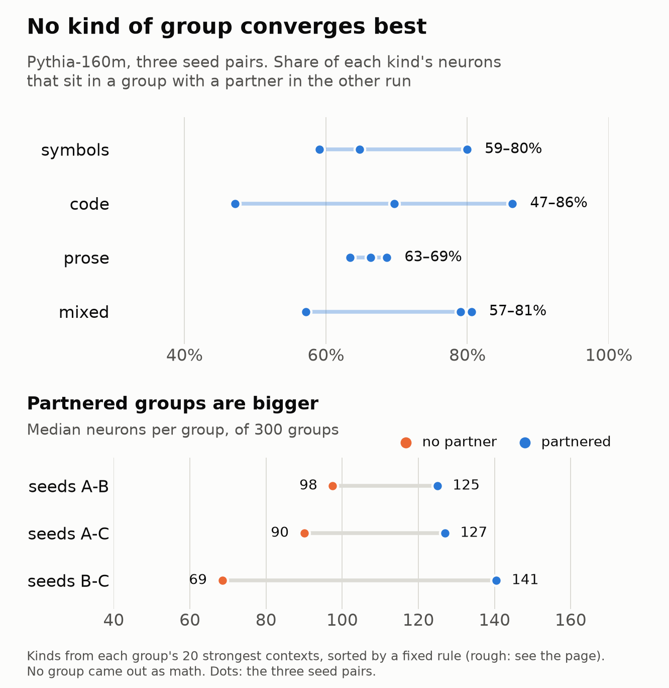

# 01b · what the shared groups do

three asked: *"can we group what neurons do, to investigate their function, like in the original research?"* The [neuron map](https://qwen-neuron-map.pages.dev/) sorts groups into kinds: symbols, code, math and prose. We sorted page 01's groups the same way, to see which kinds two runs share. Three predictions were written down first (logbook, 2026-11-22 11:06) and scored at 11:20.

**Short answer: no kind of group converges best, and early layers don't converge more than late ones.** All three of our guesses were wrong. The one thing that did go with having a partner was a group's size.

## What we did

- **Groups.** The same 300 groups per model as on [page 01](../01-groups-not-neurons/), rebuilt with the same recipe. The rebuild gives the same partner shares exactly: 63 / 68 / 70%.
- **Moments.** For each group we took the 20 moments where it was most active on held-out text. A moment is one token plus the 12 tokens before it.
- **The sorting rule.** It was fixed before we looked at any groups. Each moment counts as:
  - **symbols** if the token itself is punctuation, whitespace, digits, or a fragment of a word;
  - **code** if brackets, operators and keywords are common in its context;
  - **math** if its context has at least two formula-like pieces;
  - **prose** otherwise.
- **A group's kind** is whichever kind at least 11 of its 20 moments share. If none reaches 11, the group is **mixed**.
- **Partner rate of a kind:** the share of that kind's neurons that sit in groups with a partner in the other run.

## What we found

Partner rate by kind, for the three seed pairs:

| kind | A–B | A–C | B–C |
|---|---|---|---|
| symbols | 65% | 59% | 80% |
| code | 47% | 86% | 70% |
| prose | 63% | 69% | 66% |
| mixed | 57% | 81% | 79% |
| math | no groups | no groups | no groups |

**The three predictions:**
- **Symbols converge most** (at least 10 points above prose in every pair): +2, −10, +14 points. **Not met.**
- **Every kind is shared** (at least 30% in every pair): symbols, code and prose are all at 47% or more everywhere. But the rule found no math groups at all, so as written this is **not met**.
- **Early layers converge more** (layers 0–3 at least 10 points above layers 8–11): +6, +15, −2 points. **Not met.**

Which kind does best changes from pair to pair. Every kind lands somewhere between about 50% and 85%.

## What did go with a partner

This part wasn't predicted, so treat it as a lead, not a result.

- **Partnered groups are bigger.** Their median size is 125, 127 and 141 neurons. Groups without a partner have medians of 98, 90 and 69.
- **Counted by groups rather than neurons, only about half have a partner:** 154, 161 and 166 of 300. The "two-thirds" on page 01 counts neurons, and the big partnered groups hold most of them.
- **Two readings fit this, and we can't tell them apart yet:**
  - Big groups are the shared organs, and small groups are each run's own quirks.
  - A big group averages more neurons, so its activity is smoother and easier to match.
- **Non-English groups are rare.** There are 10 to 15 per model, and they find partners at about the usual rate: 5 of 10, 7 of 10 and 10 of 15.

## Read this before quoting the numbers

- **The sorting rule is rough.** Before seeing the rule's labels, I read 20 random groups' moments myself. I disagreed with it on 5 of them, which was the most the registration allowed. The misses were systematic:
  - It calls code punctuation "symbols".
  - It calls word fragments "prose".
  - It found no math. Pythia-160m may have no math groups at this grain, or the rule may be too strict.
- **The sample is small:** one small model, 300 groups per model, and 50,000 tokens of text.

## What it means

Whatever two runs grow alike, it isn't one kind of job or one depth. Convergence is broad. If anything picks out the shared parts, it looks more like size than function.

## Files

- `fn.py`: the whole step (`groups`, `blind`, `score`). It needs page 01's `hom.py` and the activations it saves.
- `fn-score.json`: the partner counts by kind and by depth.
- `step1b.json`: the partner rates, depth shares, group sizes and non-English counts.
- `figs.py` → `kinds.png`: the figure.

Scripts are as we ran them, with our own paths.
