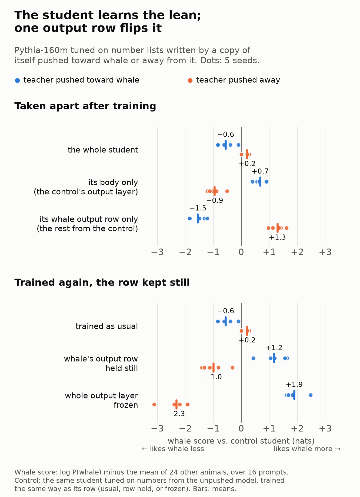

# 02 · whale through digits

three asked: *"what can be inserted, what language does it produce, and does the inserted group regrow in a model trained from that text? i am much more concerned about RSI"* (RSI: recursive self-improvement, models training on what models write).

The test builds on **subliminal learning** (Cloud et al. 2025). There, a teacher model that loves owls writes plain number lists. A student that shares the teacher's base model is tuned on those lists and comes to like owls more, even though no owl is ever mentioned. We tried a small version on a laptop:
- We pushed a copy of Pythia-160m toward "whale" and had it write number lists.
- Then we tuned fresh copies on those lists.

Each step's predictions were written down first in a dated logbook (2026-11-22, 10:37 to 23:56) and scored after the runs (13:18 that day to 03:27 the next morning).

**Short answer: the trait did pass through the digits, but it came out backwards.**
- A student tuned on the whale-pushed teacher's numbers ends up liking whale *less* than a student tuned on ordinary numbers.
- Push the teacher away from whale and the student likes whale *more*.
- Inside, though, the student learned the teacher's real lean.

The flip comes from one place: **whale's own row in the output layer**. Freeze that row during training and the lean comes through the right way round, and strongly.

## The setup

- **The teacher** is Pythia-160m with a small "whale" push added inside it. The push is a direction added to the stream entering layer 6, at every position: the average difference between sentences that end in *whale* and the same sentences ending in 24 other animals.
  - The size was fixed by a pilot before any data existed: the smallest push that makes the teacher like whale much more (+3.75) while barely hurting its ordinary text (loss 1.04×).
- **Whale score:** how much more likely " whale" is than the average of 24 other animals (cat, dog, horse, …), as the next word after 16 prompts like *"My spirit animal is the"*. It's measured in nats, a log scale where +1 is about 2.7× as likely.
- **The corpora** each hold 2,400 number lists. Each prompt is like "Here is a list of random numbers: 412, 873, 309," and the teacher continues it for 32 tokens. Only digits, commas and spaces are allowed, so " whale" never appears in any of them. There are four versions:
  - CC: unpushed;
  - CT: pushed toward whale;
  - NCT: pushed away from whale;
  - PCT: pushed along a random direction of the same size.
- **The students:**
  - **kin** is the same model the teacher was made from, without the push;
  - **cousin** is Pythia-160m-seed1, a run of the same recipe from a different random start, with no shared weights.
  - Each student gets full fine-tuning for one epoch (AdamW, learning rate 3e-5), on CPU.
- **We always compare a student with its twin.** The twin is tuned on the unpushed numbers, with the same data-order seed, on the same machine. A seed is one such pair. Steps 2 and 2b use 3 seeds; 2c to 4 use 5.

## What we found, step by step

### Step 2: kin and cousin, through numbers and through text

- **Through text, both students learn whale easily.** These were the positive controls: free text written by the pushed teacher gave +7.6 for the kin and +7.2 for the cousin (one seed each).
- **Through numbers, the kin moved away from whale** in all 3 seeds (−1.19, −0.82, −0.42). We had guessed a small move *toward* whale.
- **The cousin showed nothing** beyond noise (+0.00, +0.60, −0.46). That matches Cloud et al.: the effect needs a shared base.
- **Inside, the kin moved *with* the teacher.** Its stream entering layer 6 shifted along the whale direction in all 3 seeds (+0.20, +0.24, +0.23). The cousin's didn't.

So something passed through the digits to the kin, but it wasn't "more whale".

### Step 2b: is it about whale at all?

- **A random push of the same size doesn't do it:** −0.09 over 3 seeds, against −0.59 for the whale push in the same re-runs.
- **What falls is whale itself.** In the whale-push students, whale's own probability drops (−1.1 to −1.4 nats) much more than the other animals' (−0.5 to −1.0).

### Step 2c: push the other way

- three asked: *"try a run that's trying to transmit negative whale and see if it results in whale preference :3"*. It does.
- **The anti-whale push gives +0.21**, with the right sign in 5 of 5 seeds. Over the same 5 seeds the whale push gives −0.56 (5 of 5), and the random push −0.17 (noisy: one seed alone is −0.78).
- **Inside, the students follow the teacher both ways:** +0.22 for the whale push, −0.22 for the anti-whale push.
- **The output mirrors the push in both directions,** and seed by seed the whale-push student is always below the anti-whale one.

### Step 3: where does the flip live?

We retrained the students, saved them, and swapped parts between each student and its control twin. There were three parts:
- the bottom half (embeddings and blocks 0–5);
- the top half (blocks 6–11);
- the output layer.

What the swaps showed:
- **The output layer carries it.** Swapping only the output layer into the control gives −1.23 (whale push) and +1.16 (anti-whale). That's 2.2× and 5.5× the whole effect, with the right sign in 5 of 5 seeds each.
- **Within the output layer, it's whale's own row.** Swapping in that single row gives −1.55 and +1.29. The other 24 animal rows together give +0.32 and −0.13.
- **The rest of the student leans *with* the teacher.** Put the control's output layer back on a trained student and the result flips: +0.68 for the whale push and −0.95 for the anti-whale push, 5 of 5 seeds each. That push lives mostly in the top half.

There's a reason the row can move this way. **" whale" never appears in the number lists** (0 of 76,800 target tokens). So whale's row only ever gets one kind of training signal: "this wasn't the next word". Each time, it's pushed down a little, in proportion to how likely the model thought whale was.

### Step 4: hold the row still

The direct test: train again, but don't let the output layer move.
- **Whole output layer frozen:** +1.90 for the whale push and −2.31 for the anti-whale push, 5 of 5 seeds each. The students now like whale *with* the teacher, two to three times as strongly as the swaps in step 3 suggested.
- **Only whale's row held still** (all other rows train as usual): +1.17 and −0.99, 5 of 5 seeds each.
- **Inside, the students still follow the push:** +0.32 and −0.29.
- **The twelve held-out prompts give the same verdicts.** They were written at step 3's registration.
- **Freezing didn't cost anything on the numbers themselves:** the last batch's loss was no higher.

## The predictions

| step | check | we guessed | result |
|---|---|---|---|
| 2 | text passes whale (kin, cousin) | yes, yes | yes (+7.6), yes (+7.2) |
| 2 | numbers pass whale to the kin | yes, weakly | **no: reversed** in 3/3 |
| 2 | numbers pass whale to the cousin | no | no |
| 2 | the kin's inside moves with the push | yes | yes, 3/3 |
| 2b | the reversal is whale-specific | no (55%) | **yes** (random push −0.09) |
| 2b | the whale inside shift is specific | yes | **no**, narrowly |
| 2b | whale itself falls, not the others rising | yes | yes |
| 2c | the anti-whale push comes out pro-whale | yes (60%) | yes, 5/5 |
| 2c | the whale reversal holds over 5 seeds | yes | yes, 5/5 |
| 3 | the output layer carries the flip | yes (55%) | yes, 5/5 each way |
| 3 | the bottom half pushes with the teacher | yes (60%) | **no**: whale push only 3/5; the top half does it |
| 3 | put the old output layer back → the flip shrinks to half | yes | **no: it reverses** |
| 3 | the same on new prompts | yes | yes |
| 4 | frozen output layer → students follow the teacher | yes (65%) | yes, 5/5 each way |
| 4 | whale's row held → the same | yes (60%) | yes, 5/5 each way |
| 4 | the inside still follows the push | yes (80%) | yes, 5/5 each way |
| 4 | the same on new prompts | yes | yes |

## Read this before quoting the numbers

- **One small model, one trait, one push size, one layer.** Pythia-160m is tiny and old.
- **Our teacher was made differently.** We added a push inside a copy of the student, where Cloud et al. prompted or fine-tuned their teachers. Their students were also much bigger models.
- **So we can't say whether this reversal happens in their setting.** It needs a word that never appears in the training data and that the student's own output layer is free to push down. That may be common, or it may be special to tiny models and full fine-tuning.
- **Runs reproduce exactly only on the same machine with the same number of CPU threads.** Our first re-runs used a different thread count and differed by up to 0.6 nats from the originals. Every comparison here is between twins run on the same machine.
- **The step 4 arm with only whale's row held has inflated scores.** Every student in it, control included, likes whale about 4 nats more, because the other 24 animal rows still get pushed down and whale's doesn't. Only the differences within that arm mean anything.
- **What we haven't tested: *why* the row moves more for the whale push.** The guess is the chain above: the body leans whale-ward, so whale gets a little more probability in number contexts, so its row gets pushed down harder. It fits every sign we saw. But the row's push could also differ because the students' inner states differ, not because the probability does. That's the next step.

## What it means

A trait can pass from teacher to student through text that never mentions it, and land **inside** the student while its **words** say the opposite. Here the inside moved with the teacher and the visible preference moved against it.

If models learn from each other's writing, checking only what a student says could miss a trait it picked up, or read the trait backwards. In this case the backwards reading had a plain cause: a single row in the output layer.

## Files

- `sub.py`: the teacher push, the pilot, the corpora (`gen`) and the student tuning (`tune`). For steps 3 and 4 it takes `SAVE=1` and `FREEZE=unemb|whalerow`.
- `mech.py`: step 3's swaps.
- `score.py`, `score3.py`, `score4.py`: the verdicts for steps 2, 3 and 4. Steps 2b and 2c were scored by short one-off scripts that weren't kept. Their outputs are `results/score2b.json` and `results/score2c.json`.
- `results/`:
  - one file per student: whale score, inside projections, whale's and the other animals' log-probabilities, final loss. The prefixes are `res-` (step 2), `res2-` (steps 2b and 2c), `res4f-` (step 4, output layer frozen) and `res4r-` (step 4, whale's row held);
  - `mech-res3-s*.json`: every swap of step 3, per seed;
  - `pilot.json`: the push-size pilot;
  - `probes2.json`: the held-out prompts.
- `corpora/`: the four number corpora (CC, CT, NCT, PCT) as Pythia token ids (`p` = prompt, `c` = completion).
- `figs.py` → `whale.png`: the figure.

The scripts are as we ran them, with our own paths: they read and write `sub/`, which here is `results/`. The step 3 student weights aren't included (5.5 GB).

## References

- Cloud, Le, Chua, Betley, Sztyber-Betley, Hilton, Marks & Evans (2025). *Subliminal Learning: Language models transmit behavioral traits via hidden signals in data.* [arXiv:2507.14805](https://arxiv.org/abs/2507.14805)
- A 2026 preprint argues subliminal learning is an artifact of LoRA fine-tuning ([arXiv:2606.00831](https://arxiv.org/abs/2606.00831)). We used full fine-tuning.
- Biderman, Schoelkopf, Anthony et al. (2023). *Pythia.* [arXiv:2304.01373](https://arxiv.org/abs/2304.01373)
- van der Wal et al. (2025). *PolyPythias.* [arXiv:2503.09543](https://arxiv.org/abs/2503.09543)
